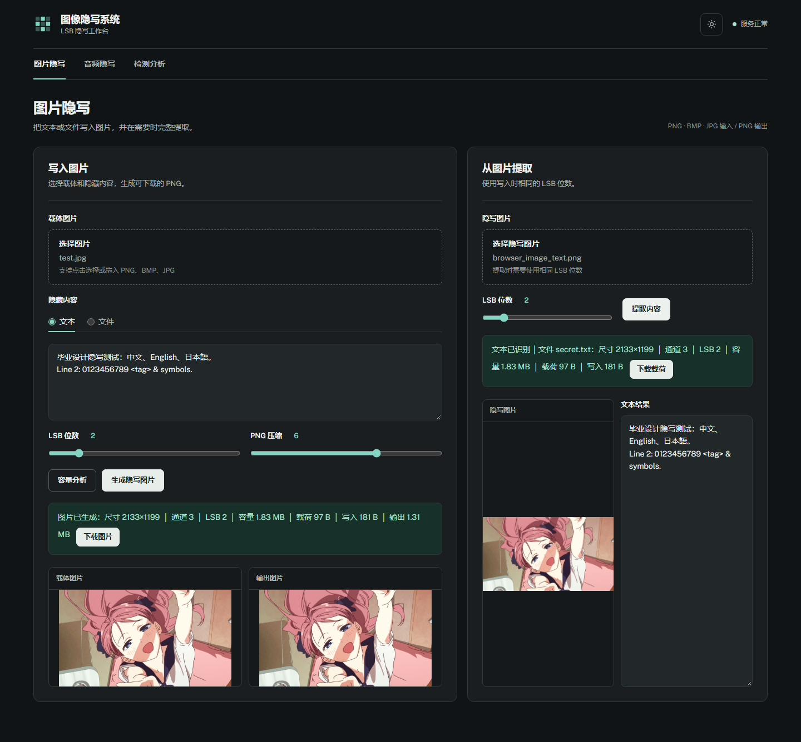

# 基于 LSB 算法的多媒体隐写系统

本毕业设计使用 Python 实现本地 Web 服务，通过中文网页完成图片与 WAV 音频中的文本或文件嵌入、提取、容量分析和结果下载。前端采用深色工作台，支持拖拽上传、媒体预览、主题切换与移动端布局。

核心位操作基于 [ragibson/Steganography](https://github.com/ragibson/Steganography)。本项目在其基础上实现网页交互、HTTP 接口、载荷元数据、WAV 自动长度恢复，以及多字节 PCM 低位处理与测试。



## 环境与启动

推荐使用 Python 3.12。本机的算法与接口检查使用 Python 3.12 验证。正常使用网页不需要 Node.js 或 FFmpeg；重新制作测试资源时需要 FFmpeg 和 FFprobe。

在 PowerShell 中执行：

```powershell
git clone https://github.com/jie322/multimedia-steganography.git
cd multimedia-steganography
py -3.12 -m venv .venv
.\.venv\Scripts\python.exe -m pip install -r requirements.txt
.\.venv\Scripts\python.exe .\webui.py
```

浏览器访问 **http://127.0.0.1:9001/**。在运行服务的终端按 `Ctrl+C` 停止服务。

Windows 也可以双击根目录的 `start.cmd`，首次运行会创建虚拟环境并安装依赖。仓库为私有时，克隆需要具有仓库访问权限的 GitHub 账号。

## 使用方法

### 图片隐写

1. 在“图片隐写”中上传 JPG、PNG 或 BMP 图片。
2. 选择隐藏文本或文件，填写内容或上传待隐藏文件。
3. 设置 LSB 位数，建议先使用默认的 2 位，点击容量分析确认可容纳。
4. 生成并下载 PNG 隐写图片。
5. 提取时上传生成的图片，使用写入时相同的 LSB 位数，恢复文本或下载原文件。

### WAV 音频隐写

1. 在“音频隐写”中上传 PCM WAV 音频。
2. 选择文本或文件载荷，查看容量后生成并下载 WAV。
3. 提取时上传生成的 WAV，设置相同的 LSB 位数，系统自动读取载荷长度并恢复内容。

系统生成的载荷保留文件名和文件类型。对于没有本系统长度标记的旧格式 WAV，可手动填写恢复长度。MP4、MP3 等可以作为待隐藏文件；音频载体应使用 WAV，MP4 当前不作为视频载体。

### 低位可视化

“检测分析”将图片指定低位映射为灰度图，用于观察低位纹理。该图仅供人工分析，系统不据此自动判定图片是否包含隐写内容。

## 测试与资源

`test_resources/` 保留原始 JPG、MP4 及由视频制作的 WAV、MP3、短视频和其他测试载荷。原视频约 23MB，5 秒短视频约 130KB；2 位 LSB 下，测试图片容量约 1.9MB，20 秒 WAV 容量约 480KB。

执行算法和 HTTP 接口回归检查：

```powershell
.\.venv\Scripts\python.exe .\test\run_project_tests.py
```

脚本会自行启动临时端口的测试服务，结果写入 `output/testing/`。上传前的复核结果及浏览器流程记录见 [测试报告](docs/testing/测试报告.md)。

如需从原始视频重新制作测试资源，先确保 FFmpeg、FFprobe 可以在终端调用，再执行：

```powershell
.\.venv\Scripts\python.exe .\test\prepare_resources.py
```

可选的浏览器流程检查需要 Node.js 和 Playwright。先启动 `webui.py`，再在另一个终端执行：

```powershell
npm install --no-save --package-lock=false playwright
npx playwright install chromium
node .\test\browser_smoke.js
```

浏览器检查结果和截图写入 `output/`。测试服务地址可通过环境变量 `STEGO_BASE_URL` 设置，默认使用 `http://127.0.0.1:9001/`。

## 项目结构

```text
multimedia-steganography/
├─ html/                 # 网页结构、样式和交互
├─ stego_lsb/            # LSB 核心算法与命令行入口
├─ test/                 # 资源制作与回归检查
├─ test_resources/       # 原始及已准备好的测试媒体
├─ docs/                 # 页面截图与测试记录
├─ webui.py              # 本地 Web 服务
├─ start.cmd             # Windows 启动入口
├─ requirements.txt      # 依赖安装入口
├─ pyproject.toml        # Python 包配置
├─ LICENSE.md            # MIT 许可证
└─ AUTHORS.md            # 原项目署名及扩展说明
```

## 算法与使用范围

提高 LSB 位数能够增加容量，同时会增加像素或音频采样值的改动。图片结果使用 PNG 保存；重新压缩为 JPG、音频转码或再次编辑可能破坏隐藏内容。普通 LSB 不提供加密、身份认证或抗统计检测能力。

原项目命令行入口仍可使用：

```powershell
stegolsb steglsb -h -i carrier.png -s secret.txt -o encoded.png -n 2
stegolsb steglsb -r -i encoded.png -o recovered.txt -n 2
```

源码沿用 MIT 许可证并保留 Ryan Gibson 的版权声明。测试图片、音视频仅用于本项目复核，其权利归原权利人所有。
